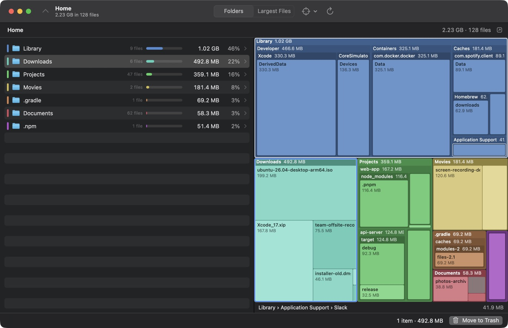

# Garbage Collector

**Garbage collection for your disk, not your heap.** A free, native macOS app that shows what
is taking up your disk and lets you send the junk to the Trash.



> **Not that kind of garbage collector.** Nothing here walks a heap or pauses your runtime.
> This one is mark-and-sweep by hand: *you* mark what is garbage, and it sweeps it into the
> Trash. It is also fully stop-the-world, in the sense that nothing happens until you say so.

- **List** of the current folder, largest first, with a proportional bar and the share of the folder.
- **Treemap** next to it: the area of each block is the space it takes; colors match the list.
- **Largest Files**: the 200 largest files of the whole tree, whatever folder they are in.
- **Trash**: select, confirm, and it goes to the macOS Trash. Nothing is deleted directly.

SwiftUI + SwiftPM, no dependencies, no network requests, no telemetry. The `.app` is about 1 MB.
The interface is available in English and Brazilian Portuguese.

## Install

There is no prebuilt download yet: the app is not notarized, so you build it yourself.
You need macOS 14 or later and Xcode (or the Command Line Tools) with Swift 6.

```bash
git clone https://github.com/sevdoug/garbage-collector.git
cd garbage-collector
scripts/bundle.sh --install  # builds and copies the app to /Applications
```

To build without installing:

```bash
scripts/bundle.sh            # creates dist/Garbage Collector.app
open "dist/Garbage Collector.app"
```

To open it already scanning a folder:

```bash
open "dist/Garbage Collector.app" --args /path/to/folder
```

While developing, `swift run GarbageCollector` also works (no icon, no Info.plist, English only).

### Apple Silicon and Intel

The code has nothing specific to one architecture, and `swift build` produces a binary for the
Mac it runs on, so it builds natively on both. Development happens on Apple Silicon with
macOS 26. An Intel (x86_64) build was run through Rosetta, not on Intel hardware, and macOS 14
and 15 are supported by the deployment target but untested. Reports are welcome.

## Use

| Action | How |
| --- | --- |
| Open a folder | double-click in the list or the treemap, or Return |
| Go back | ⌘↑, the ⌃ button in the toolbar, or a segment of the path at the top |
| Select several | ⌘-click / ⇧-click in the list; ⌘-click in the treemap |
| Move to Trash | ⌘⌫, the button in the status bar, or right-click |
| Show in Finder / copy path | right-click |
| Rescan | ⌘R (returns to the folder you were in) |
| Choose another folder | ⌘O |

In each folder, files smaller than 1 MB are added up into a single row
("N files smaller than 1 MB"). **Expand** lists the 1,000 largest of them.

The space only really comes back when you **empty the Trash**. The status bar shows how much
you have sent there in the session and has a shortcut to open it.

## Permissions

macOS protects some folders. Without permission the app still works, but those folders are
left out of the totals and show up in the "N unreadable folders" warning in the status bar.

To see everything: **System Settings → Privacy & Security → Full Disk Access**, add
Garbage Collector, then scan again.

The app is ad-hoc signed (no developer certificate). macOS ties the permission to that
signature, so **after rebuilding you may have to grant access again**.

## How size is counted

Same rules as `du`, and the totals match it:

- **Size allocated on disk**, not the logical size. Sparse files (e.g. `Docker.raw`) and files
  that only exist in iCloud count what they really take.
- **Hard links count once**: the first path found gets the size.
- **Symbolic links are not followed.**
- **It does not cross volumes**: external disks mounted inside the folder show as "other volume".
- **Cloud-only folders are not listed** (listing them would force a download).

"Whole Disk" scans the data volume (`/System/Volumes/Data`), where your files, apps and the
system library live. The system volume (sealed, read-only) is left out.

## Safety

- **Nothing is deleted permanently.** The only destructive action is moving items to the
  Trash, always after a confirmation dialog. The app never empties the Trash.
- **Structural folders are refused**: the disk root, system folders, volume roots, your home
  folder, its standard folders (`Documents`, `Downloads`, `Library`…) and the first level of
  `~/Library`. Their **contents** remain available. The rules live in
  `Sources/ScanCore/TrashGuard.swift`, with a test for each case.
- **The check runs again against the disk at the moment of moving.** If a folder in the path
  has become a symbolic link since the scan (so the path now points somewhere else), the item
  is refused and the app asks for a new scan.
- **No network, no telemetry.** The app makes no network requests and stores nothing about
  your files.

It is still a tool that moves your files: read the confirmation before you click.

## Known limitations

- **The space freed can be smaller than shown** when there are hard links (e.g. pnpm's
  `node_modules`, which point into the store) or APFS clones (copies made in Finder): the space
  only comes back when the last path to the data is gone.
- **Local Time Machine snapshots and "purgeable" space** do not appear in the scan, so the
  total can be smaller than the "used" figure macOS reports.
- **The tree is a snapshot of the scan.** Changes made elsewhere only show up after a rescan.
  If a selected item no longer exists, it just leaves the list.
- **The on-disk check is not atomic.** A tiny window remains between the check and the move,
  because the macOS Trash API takes paths, not file descriptors.
- **"Put Back"**: items are trashed through the API that moves them "the same way Finder does"
  (`NSWorkspace.recycle`), but the Trash's "Put Back" option has not been verified by hand.
- macOS only. It does not empty the Trash or delete permanently (on purpose).

## Code

```
Sources/ScanCore/          pure logic, no UI
  Scanner.swift            parallel scan (readdir + fstatat), aggregation and progress
  DirectoryReader.swift    low-level reading of one directory
  FileNode.swift           tree node
  TreeEditor.swift         remove a node, expand small files, largest files
  Treemap.swift            "squarified" layout
  TrashGuard.swift         what may and may not go to the Trash
Sources/GarbageCollector/  SwiftUI app
  AppModel.swift           state: scan, navigation, selection, trash
  BrowserView.swift        main window, path bar, status bar, alerts
  ItemListView.swift       list and "Largest Files"
  TreemapView.swift        treemap (Canvas)
Resources/*.lproj          translations (the strings in the code are English)
scripts/bundle.sh          assembles the .app
scripts/make-icon.sh       regenerates Resources/AppIcon.icns
```

To add a language, copy `Resources/pt-BR.lproj`, translate the right-hand side of each line,
and add the language code to `CFBundleLocalizations` in `scripts/bundle.sh`.

## Tests

```bash
swift test
```

The tests create temporary folders with the hard cases (sparse file, hard link, symlink loop,
folder without permission) and compare the totals against `du -sk`.

To measure time and memory on a real folder (read-only):

```bash
GC_BENCH_PATH=~/Library swift test -c release -Xswiftc -enable-testing --filter benchmark
```

Reference (Apple Silicon MacBook, cold cache):

| Target | Files | Size | Time | Peak memory |
| --- | --- | --- | --- | --- |
| `~/Library` | 1.26 million | 149 GiB | 12.5 s | 80 MiB |
| Whole disk (`/System/Volumes/Data`) | 4.4 million | 388 GiB | 29 s | 213 MiB |

## License

[MIT](LICENSE)
